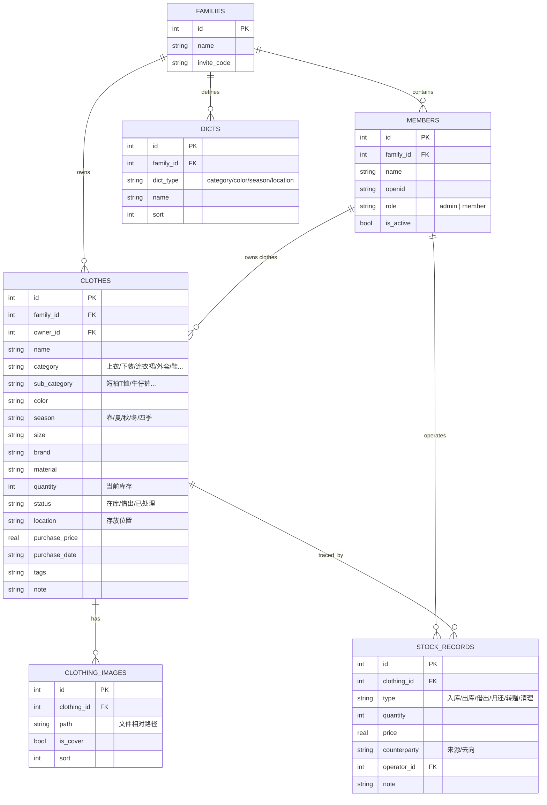

# 家庭衣橱进销存 · 微信小程序架构设计

> 版本 v1.0 · 2026-08-11 · 部署环境：飞牛OS（家庭内网）· 使用范围：仅家人

---

## 一、需求理解

**一句话定义**：一款只给家人使用的微信小程序，管理全家衣服的进销存；图片存在飞牛文件里；按成员、种类、颜色、季节等维度分类；后端服务跑在飞牛OS 上。

| 功能点 | 说明 |
|---|---|
| 家人管理 | 添加家庭成员、绑定微信身份、区分"谁的衣服" |
| 衣服管理 | 新增/编辑/删除、多图、完整属性（种类/颜色/季节/尺码/品牌…） |
| 进销存 | 入库（买进）、出库（卖掉/送人/清理）、借出/归还，流水可追溯，库存自动联动 |
| 分类维度 | 种类（上衣/裤子/裙子/外套/鞋…）、颜色、季节（春夏秋冬）、成员、存放位置、标签 |
| 图片存储 | 拍照/相册多图上传，图片文件保存在飞牛文件系统 |
| 数据看板 | 总数、成员分布、季节分布、近期流水、按需统计 |

---

## 二、核心约束与关键决策（必读）

### 决策 1：家庭内网如何被微信小程序访问？—— 这是整个架构最重要的点

微信小程序**正式发布版**强制要求：所有请求必须是 **HTTPS + 已备案的合法域名**（配置在小程序后台）。
你只有家庭内网、无公网域名，**正式版这条路走不通，但我们不需要走**。

**方案：用「体验版 + 开发者工具关闭域名校验 + 局域网 HTTP」上线，0 成本、当天可用。**

- 开发版 / 体验版可以绕过域名校验（在微信开发者工具：`详情 → 本地设置 → 勾选"不校验合法域名、web-view…"`）。
- 家人手机上通过**体验版二维码**扫码使用，走 `http://<飞牛IP>:3000` 直连局域网，不需要公网、不需要证书、不需要备案。
- 体验版二维码长期有效，每次用开发者工具"上传"新代码即可更新版本，家人无需重装。
- 前提：家人的微信需要被添加为小程序的**体验成员**（最多可加几百人，家庭绰绰有余）。

> ⚠️ 唯一的坑：**正式发布版**无法绕过校验。只要我们不"提交审核发布正式版"，就一直走体验版，完全够家人用。

**升级路径（将来想随时随地访问 / 开放给别人）**：飞牛加 frp 内网穿透或 Tailscale VPN + 备案域名，前端只改一个 `BASE_URL`，架构不用动。

### 决策 2：小程序账号主体

- **个人主体小程序**即可（无需企业资质、无需微信支付、无认证费）。
- 需要去微信公众平台注册一个个人小程序，拿到 `AppID`，并在后台添加项目成员（开发者本人）+ 体验成员（家人）。
- 记得在后台配置一份《用户隐私保护指引》（涉及 openid/头像收集时必填，否则接口可能受限）。

### 决策 3：登录极简（仅家人场景）

- 不用手机号、不用密码。`wx.login()` 拿到 code → 后端换 openid → 绑定到某个家庭成员。
- 首次进入：管理员（创建家庭的人）添加成员，家人第一次打开时选择自己的名字完成绑定。

### 决策 4：技术栈

| 层 | 技术 | 理由 |
|---|---|---|
| 前端 | 微信原生小程序（WXML/WXSS/JS） | 轻量、无框架学习成本、官方支持最好 |
| 后端 | Node.js 20 + Fastify | 与前端同为 JS，生态成熟、启动快 |
| 数据库 | SQLite（better-sqlite3） | 单文件、零运维、天然适合家庭场景，飞牛上定时备份即安全 |
| 图片 | 本地文件系统 + multer 上传 | 图片就落在飞牛共享目录，符合"图片放文件里" |
| 部署 | Docker + docker-compose | 飞牛OS 自带 Docker，一条命令拉起 |

---

## 三、总体架构

```
┌─────────────────────────────────────────────┐
│  微信小程序（家人手机 · 体验版 · 不校验域名）      │
│  看板 / 衣橱 / 详情 / 新增 / 成员 / 设置         │
└──────────────────┬──────────────────────────┘
                   │ wx.request / wx.uploadFile
                   │ http://<飞牛IP>:3000 （家庭局域网）
┌──────────────────▼──────────────────────────┐
│  飞牛OS · Docker 容器（Node.js 后端）           │
│  Fastify 路由 + 鉴权 + 业务逻辑                 │
├──────────────────┬──────────────────────────┤
│  SQLite           │  图片文件目录               │
│  closet.db        │  /vol1/closet/images      │
│  （挂载数据卷）      │  （挂载飞牛共享目录）        │
└──────────────────┴──────────────────────────┘
```

**数据流**：
1. 小程序 `utils/request.js` 统一封装请求，附带身份 token（openid）。
2. 后端 Fastify 处理 `/api/*`，读写 SQLite；`POST /api/clothes/:id/images` 用 multer 把图片写入挂载的共享目录。
3. 图片通过 `GET /uploads/*` 静态服务返回，小程序 `<image>` 直接渲染。
4. 进销存操作：先写 `stock_records` 流水，再在同一事务里更新 `clothes.quantity`，保证一致。

---

## 四、项目目录结构

### 飞牛侧（后端 + 数据）

```
/vol1/closet/
├── docker-compose.yml        # 一键部署
├── app/                      # 后端代码（源码挂载进容器）
│   ├── package.json
│   └── src/
│       ├── server.js         # 入口
│       ├── config.js         # 端口/路径/环境
│       ├── db.js             # SQLite 初始化 + 建表
│       ├── auth.js           # wx.login 换 openid 中间件
│       ├── routes/           # clothes / members / stock / stats / dicts
│       └── upload.js         # multer 图片上传
├── data/                     # SQLite 数据库文件（建议放飞牛存储卷，受 RAID 保护）
│   └── closet.db
└── images/                   # 图片文件（挂载飞牛共享目录，可在飞牛"文件"里直接浏览）
    └── <衣服ID>/xxx.jpg
```

### 小程序侧（微信开发者工具导入）

```
closet-miniprogram/
├── app.js / app.json / app.wxss
├── project.config.json       # 填入 AppID
├── sitemap.json
├── utils/
│   ├── request.js            # 统一请求封装（BASE_URL 在此配置）
│   └── util.js               # 格式化等
├── services/api.js           # 所有接口方法
├── components/
│   ├── clothing-card/        # 衣服卡片（缩略图+名称+成员）
│   └── filter-bar/           # 筛选条（成员/种类/颜色/季节）
└── pages/
    ├── dashboard/            # 首页看板（tab）
    ├── closet/               # 衣橱列表（tab）
    ├── mine/                 # 我的（tab）
    ├── detail/               # 衣服详情 + 流水 + 操作
    ├── edit/                 # 新增 / 编辑衣服
    ├── members/              # 成员管理
    └── settings/             # 设置（字典维护、关于）
```

> 主包控制在 2MB 内毫无压力，MVP 阶段不需要分包；后续加统计报表等重页面时再拆分包。

---

## 五、数据模型设计



**进销存逻辑**：
- `clothes.quantity` 是当前库存（"存"）；每次变动都写一条 `stock_records`（"进/销"），两者在同一个 SQLite 事务里完成，不会不一致。
- 出库数量 ≥ 库存时置 `status=已处理`；借出时 `status=借出`，归还后自动回"在库"。
- 字典表支持自定义种类/颜色/存放位置，家庭可按自己习惯扩展（比如加"童装"分类）。

---

## 六、API 设计

| 方法 | 路径 | 说明 |
|---|---|---|
| POST | `/api/auth/login` | `wx.login` code 换 openid，返回家庭+成员信息 |
| GET | `/api/family` | 家庭信息 + 成员列表 |
| POST | `/api/members` | 添加成员（管理员） |
| PUT | `/api/members/:id` | 编辑成员 / 绑定微信身份 |
| GET | `/api/clothes` | 列表（成员/种类/颜色/季节/状态/搜索 + 分页） |
| POST | `/api/clothes` | 新增衣服 |
| GET | `/api/clothes/:id` | 详情（含图片、最近流水） |
| PUT | `/api/clothes/:id` | 编辑衣服 |
| DELETE | `/api/clothes/:id` | 删除（软删除，保留流水） |
| POST | `/api/clothes/:id/images` | 上传图片（multipart，多图） |
| DELETE | `/api/clothes/:id/images/:imgId` | 删除单张图片 |
| POST | `/api/clothes/:id/stock` | 记流水（入库/出库/借出/归还/转赠/清理），自动更新库存 |
| GET | `/api/clothes/:id/records` | 该衣服的全部流水 |
| GET | `/api/stats/overview` | 看板统计（总数/成员分布/季节分布/近期流水） |
| GET | `/api/dicts` · PUT `/api/dicts` | 字典查询 / 维护 |
| GET | `/uploads/*` | 图片静态访问 |

**统一约定**：返回 `{ code, data, message }`；请求头带 `X-Token`（openid）；所有接口按 `family_id` 隔离，天然适合单家庭场景。

---

## 七、小程序页面与交互设计

**tabBar（3 个）**：`首页看板` · `衣橱` · `我的`

| 页面 | 路径 | 核心内容 |
|---|---|---|
| 首页看板 | pages/dashboard | 总件数、按成员分布、季节分布、最近入库/出库、快捷"＋"录入 |
| 衣橱 | pages/closet | 衣服瀑布流卡片 + 顶部筛选条（成员/种类/颜色/季节/状态）+ 搜索 |
| 衣服详情 | pages/detail | 图片轮播、完整属性、进销存流水、操作按钮（记一笔/编辑/删除） |
| 新增/编辑 | pages/edit | 拍照/相册多图、选成员、选种类/颜色/季节（带自定义）、数量、价格、位置、备注 |
| 我的 | pages/mine | 当前成员、成员管理入口、设置、字典维护、数据导出 |
| 成员管理 | pages/members | 添加家人、改名、绑定微信 |

**关键流程**：
1. **首次使用**：打开 → 自动 `wx.login` → 后端匹配 openid → 未绑定则提示"选择我是谁"或"创建家庭"。
2. **录入一件衣服**（全程 10 秒）：衣橱页点"＋" → 拍照 → 默认归属自己、自动判断当前季节 → 选种类/颜色 → 保存。
3. **出库/借出**：详情页 → "记一笔" → 选类型（出库/借出/清理）→ 填去向 → 库存自动减，状态自动变。

---

## 八、飞牛部署方案（docker-compose 一键起）

```yaml
# /vol1/closet/docker-compose.yml
services:
  closet-api:
    image: node:20-alpine
    container_name: closet-api
    restart: unless-stopped
    working_dir: /app
    command: sh -c "npm install --omit=dev && node src/server.js"
    volumes:
      - ./app:/app                  # 后端代码
      - ./data:/app/data            # SQLite 数据库（放飞牛存储卷，受保护）
      - /vol1/closet/images:/app/images   # 图片文件（飞牛共享目录）
    ports:
      - "9990:3000"                    # 外部 9990 → 容器 3000
    environment:
      - PORT=3000
      - DB_PATH=/app/data/closet.db
      - IMAGES_DIR=/app/images
      - NODE_ENV=production
```

**部署步骤**：
1. 飞牛 OS 里把 `/vol1/closet` 建在存储卷上（有 RAID/快照保护）。
2. 上传 `docker-compose.yml` + `app/` 代码到 `/vol1/closet`。
3. 飞牛"应用中心 / Docker"里导入 compose 并启动（或 SSH 执行 `docker compose up -d`）。
4. 浏览器访问 `http://<飞牛IP>:9990/api/family` 自测。
5. 微信开发者工具：详情 → 本地设置 → 勾选"不校验合法域名"；`BASE_URL = http://<飞牛IP>:9990`；上传代码 → 生成体验版 → 家人扫码。

**备份**：SQLite 是单文件，配置飞牛定时任务每日 `cp data/closet.db backup/` 即可（或飞牛自带应用备份）；图片目录用飞牛的文件夹备份/同步功能。

---

## 九、快速上线路线图（3~5 天）

| 阶段 | 内容 | 验收标准 | 预计 |
|---|---|---|---|
| 1 骨架 | 后端建表 + auth；小程序骨架 + tabBar + request 封装 | 小程序能启动、能登录返回成员 | 第 1 天 |
| 2 核心 | 衣服增删改查 + 筛选搜索 + 多图上传；成员管理 | 能完整录入一件带图衣服并筛选 | 第 2~3 天 |
| 3 进销存 | 流水 + 库存联动 + 看板统计 | 入库/出库后库存与流水正确 | 第 4 天 |
| 4 上线 | 飞牛部署 + 体验版 + 家人扫码 + 真实数据录入 | 家人手机可用、数据正常 | 第 5 天 |

---

## 十、风险与注意事项（务必看）

1. **域名校验（最大坑）**：正式发布版强制 HTTPS+备案域名，**永远不要点"提交审核/发布"**；只走体验版。每次更新代码都通过开发者工具"上传"并让家人重新扫码（或直接打开同一二维码，版本自动更新）。
2. **体验成员**：家人微信必须被添加为体验成员，否则打不开体验版（小程序后台 → 成员管理 → 体验成员）。
3. **隐私保护指引**：小程序后台需配置《用户隐私保护指引》，涉及 openid 与头像昵称收集，否则相关接口可能报错。
4. **仅内网可用**：家外无法访问；如需要，后续加 Tailscale（免费 VPN）或 frp 内网穿透 + 备案域名，前端只改 `BASE_URL`。
5. **图片安全**：家人场景可先不做内容安全检测；将来开放再接入 `msgSecCheck`。
6. **数据备份**：SQLite 单文件 + 图片目录，务必配每日定时备份，避免飞牛磁盘故障丢数据。

---

## 十一、交付物与下一步

**本次交付**：
- 本文档（架构设计）
- `deploy/docker-compose.yml`（可直接部署）

**下一步（确认后即可开工）**：
1. 搭建后端完整代码（Fastify + SQLite + 全部 API + 建表）
2. 搭建小程序完整代码（全部页面 + 组件 + 请求封装）
3. 本地跑通 → 给你飞牛部署清单 → 生成体验版上线

> 建议按"先跑通骨架 → 再补功能"推进，最快第 3 天家人就能用上。
